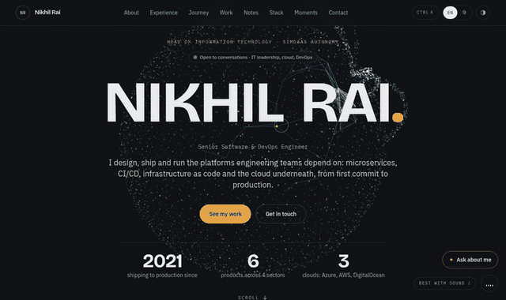

<a href="https://nikhil-rai-portfolio-xi.vercel.app">
  
</a>

<h1 align="center">Hi, I'm Nikhil Rai 👋</h1>

<p align="center">
  <a href="https://nikhil-rai-portfolio-xi.vercel.app">
    
  </a>
</p>

<p align="center">
  <a href="https://nikhil-rai-portfolio-xi.vercel.app"></a>
  <a href="https://www.linkedin.com/in/nikhil-rai-551219183/"></a>
  <a href="mailto:nikhilrai662@gmail.com"></a>
  <a href="https://instagram.com/officialraisahabh"></a>
</p>

<p align="center">
  
</p>

---

### 🛰️ Right now

- 🏢 Running IT, cloud and infrastructure at **[SimDaaS Autonomy](https://www.simdaas.com/)** (IIT Kanpur): security policy, cloud accounts and cost, licensing, and the server-side APIs our products depend on.
- 🛡️ Building small, sharp open-source tools for **AI-agent safety** and **cloud hygiene**.
- 🎨 Just open-sourced **[my portfolio](https://github.com/nikhilrai-tech/portfolio)**: fork it and make it yours.
- 📷 Off the terminal, I'm behind a camera.

### ✨ Featured: this portfolio, open source

<table>
  <tr>
    <td width="50%">
      <a href="https://nikhil-rai-portfolio-xi.vercel.app"></a>
    </td>
    <td width="50%">
      <a href="https://nikhil-rai-portfolio-xi.vercel.app"></a>
    </td>
  </tr>
</table>

**[nikhilrai-tech/portfolio](https://github.com/nikhilrai-tech/portfolio)**: Next.js 16, a three.js particle field that morphs per section, a GSAP scroll film, Netflix-style profiles, a free AI chat with fallbacks, generated music, PWA, and English/Hindi. The README explains how each piece works, so you can learn from it or ship your own in an afternoon.

[**▶ Live site**](https://nikhil-rai-portfolio-xi.vercel.app) · [**Source**](https://github.com/nikhilrai-tech/portfolio) · [**Make it yours**](https://github.com/nikhilrai-tech/portfolio#make-it-yours-in-10-minutes) · ⭐ a star helps others find it

### 🧰 Open source

| Project | What it does | |
| --- | --- | --- |
| 🦺 **[seatbelt for AI agents](https://github.com/nikhilrai-tech/seatbelt-for-AI-agents)** | Reads the shell commands an AI coding agent is about to run and blocks or asks before the dangerous ones: secrets, prod deletes, prompt injection. Zero dependencies. | [PyPI](https://pypi.org/project/seatbelt-guard/) |
| 🔎 **[cloud-ownerlens](https://github.com/nikhilrai-tech/cloud-ownerlens)** | Finds unused cloud resources nobody owns, infers the owner, scores the waste and asks before anyone touches anything. Read-only. | AWS |
| 🛡️ **[ScamSaathi](https://github.com/nikhilrai-tech/ScamSaathi)** | Offline, multilingual scam shield for farmers, students and families, with a trusted-person alert loop. | [Try it](https://nikhilrai-tech.github.io/ScamSaathi/) |

### 🚀 Products I've built and run

| Product | What it is | Stack |
| --- | --- | --- |
| [**AI Varta**](https://aivarta.in/) | AI chatbot for websites, SkyAI's flagship product | Django · PostgreSQL · Razorpay · DigitalOcean |
| [**VTV Gujarati News**](https://www.vtvgujarati.com/) | High-traffic news platform on microservices | Django · Wagtail · Kubernetes · Jenkins |
| [**SecuriumX**](https://www.securiumx.com/) | Bug bounty and CTF platform connecting businesses with ethical hackers | Django · React · Vue.js · Azure |
| [**Persius**](https://persius.in/) | Marketplace for creative talent: jobs, gigs, workshops, courses | Django · RabbitMQ · Terraform · AWS |
| [**Aethrone Aerospace**](https://www.aethroneaerospace.com/) | Web app for an aerospace and defense startup at SIIC-IIT Kanpur | Django · React · MySQL · DigitalOcean |
| **Network Operations Dashboard** | Real-time network ops data for Airtel's NOC | Django · PostgreSQL · REST API · Docker |

### 🧭 Journey

```text
2021 ── Bharti Airtel ──────── NOC Developer                         Gurugram
2022 ── Cyber3ra ───────────── Software Engineer                     IIT Kanpur
2024 ── SkyAI Technologies ─── Software Engineer / AI & Cloud        IIT Kanpur
2025 ── SimDaaS Autonomy ───── Software Development Engineer II      IIT Kanpur
2026 ── SimDaaS Autonomy ───── Head of Information Technology  ◀ now IIT Kanpur
```

Telecom → cybersecurity → AI and cloud → autonomy. [Watch it as a scroll film ▶](https://nikhil-rai-portfolio-xi.vercel.app/en#journey)

### 📝 Latest notes

<!-- NOTES:START -->
- [A seatbelt for AI coding agents](https://nikhil-rai-portfolio-xi.vercel.app/en/notes/seatbelt-for-ai-agents)
- [ScamSaathi: an offline scam shield in Hindi and English](https://nikhil-rai-portfolio-xi.vercel.app/en/notes/scamsaathi)
- [Finding the owner of forgotten cloud resources](https://nikhil-rai-portfolio-xi.vercel.app/en/notes/cloud-ownerlens)
<!-- NOTES:END -->

<sub>Updated automatically from the portfolio's [RSS feed](https://nikhil-rai-portfolio-xi.vercel.app/feed.xml).</sub>

### 🛠️ Tech stack

<p align="center">
  
</p>

<p align="center"><sub>Also: Django REST Framework · Wagtail · Celery · DigitalOcean · SonarQube · BetterStack</sub></p>

### 📊 GitHub

<p align="center">
  <picture>
    <source media="(prefers-color-scheme: dark)" srcset="https://github-readme-stats.vercel.app/api?username=nikhilrai-tech&show_icons=true&hide_border=true&include_all_commits=true&count_private=true&theme=github_dark&bg_color=0d1117&icon_color=EBA73F&title_color=EBA73F" />
    
  </picture>
  <picture>
    <source media="(prefers-color-scheme: dark)" srcset="https://streak-stats.demolab.com?user=nikhilrai-tech&hide_border=true&theme=github-dark-blue&background=0d1117&ring=EBA73F&fire=EBA73F&currStreakLabel=EBA73F" />
    
  </picture>
</p>

<p align="center">
  <picture>
    <source media="(prefers-color-scheme: dark)" srcset="https://raw.githubusercontent.com/nikhilrai-tech/nikhilrai-tech/output/snake-dark.svg" />
    
  </picture>
</p>

### 📬 Let's talk

Infrastructure, DevOps, Python or photography: write to **[nikhilrai662@gmail.com](mailto:nikhilrai662@gmail.com)**, connect on [LinkedIn](https://www.linkedin.com/in/nikhil-rai-551219183/), or [ask the AI on my portfolio](https://nikhil-rai-portfolio-xi.vercel.app) anything about my work.

<p align="center"><sub>⭐ <a href="https://github.com/nikhilrai-tech/portfolio">Star the portfolio</a> if it taught you something</sub></p>
